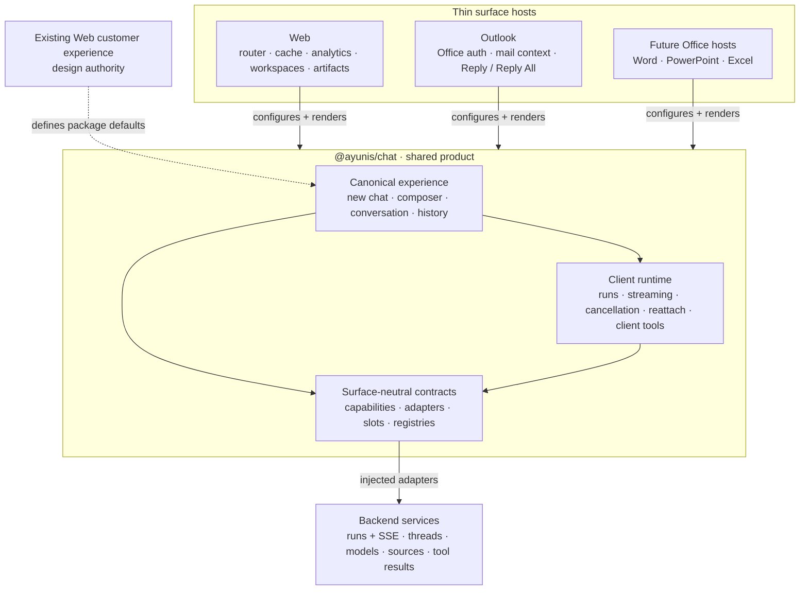

# Chat surface architecture

`@ayunis/chat` owns one Ayunis chat product. The established Web experience is
the canonical design and interaction contract. Web, Outlook, and future Office
applications configure that product; they do not copy or restyle it.

An Outlook task pane is a narrow host, not the Web phone experience. Width can
change layout where the canonical component explicitly supports it, but it does
not authorize an Office-specific hierarchy or visual language. Any intentional
visual or interaction deviation needs product approval before implementation.

## Target dependency direction

The dependency direction is one-way: hosts import `@ayunis/chat`; the package
never imports a host. `ayunis-core-frontend/.dependency-cruiser.cjs` enforces
that boundary for the Web application and every `apps/*` host. The package
ESLint configuration rejects surface-named behavior and styling branches.

## Ownership contract

| Concern                 | Package owns                                                                                                            | Host supplies                                                                |
| ----------------------- | ----------------------------------------------------------------------------------------------------------------------- | ---------------------------------------------------------------------------- |
| Product presentation    | Message hierarchy, timeline, composer primitives, model presentation, history rows, new-chat primitives, shared notices | Approved content and actions through named slots                             |
| Run lifecycle           | Send, stream, cancel, reattach, event routing, reconciliation                                                           | `RunEndpoints`, cache refresh, analytics, authentication recovery            |
| Principal/session state | Session reset, thread-local run state, drafts through `ChatDraftStorage`                                                | Stable `sessionKey` and principal-scoped storage                             |
| Capabilities            | Consistent hiding/disabling of unsupported controls                                                                     | `ChatCapabilities` derived from the authenticated surface scopes             |
| Models                  | Canonical selector and model/mode presentation                                                                          | Available models, selected value, and `ChatModelAdapter.select`              |
| Attachments             | Selection state, pending previews, upload policies, composer integration                                                | Upload operation, authenticated source data, attachment errors               |
| Voice                   | Recording interaction and composer state                                                                                | Transcription adapter and capability                                         |
| History                 | Canonical list and row presentation                                                                                     | Client-scoped query data, pagination, rename/delete operations, navigation   |
| Client tools            | Registry, dispatch, consent, deferred results, result routing                                                           | Office.js or other host executor and its context                             |
| Rich tools/artifacts    | Registry-driven timeline cards                                                                                          | Registrations and `onOpenArtifact` host action                               |
| Host context            | Typed slots in `ChatConversationSlots`                                                                                  | Workspaces, onboarding, mail/document context, source chips, host navigation |

Core presentation has no generic render override or theme prop. Slots are
named for host-owned content and actions; they must not replace or restyle the
composer, conversation timeline, history, or new-chat shell.

## Public host boundaries

| Boundary             | Contract                                          | Valid host responsibility                                                   |
| -------------------- | ------------------------------------------------- | --------------------------------------------------------------------------- |
| Transport            | `ChatSurfaceConfig.transport`                     | Connect authenticated or visitor endpoints with the shared event format     |
| Feature availability | `ChatSurfaceConfig.capabilities`                  | Declare support; never use a surface name as the condition                  |
| Conversation data    | `ChatConversationProps.thread` and `activeRun`    | Supply snapshots scoped to the current principal and client                 |
| Runtime effects      | `ChatConversationAdapters`                        | Upload, transcribe, select a model, refresh host caches, handle auth/errors |
| Deferred context     | `deferSend` and `ChatConversationHandle`          | Report host context readiness; never execute or stream the run in the host  |
| Product extensions   | `ChatConversationSlots`                           | Supply named content/actions that remain host-owned                         |
| Client tools         | `ClientToolDispatch` and the client-tool registry | Execute host APIs; the package coordinates lifecycle and results            |
| Rich cards           | Tool-card registry and `TimelinePresentation`     | Register domain cards and artifact opening behavior                         |
| Drafts               | `ChatDraftStorage`                                | Persist drafts under a principal-, client-, and context-safe key            |

Web router/AppLayout, TanStack Query ownership, analytics, workspaces,
onboarding, and artifact panels stay in the Web host. Office authentication,
Office.js, current mail/document context, Reply/Reply All, and client-tool
executors stay in the Office host. Outlook history remains scoped with
`client=outlook`; Web and Outlook histories must not mix. Office manifests and
task-pane URLs are outside the package contract.

## Parity baseline

Visual evidence is captured at the affected viewport during each migration PR;
it is not stored as brittle screenshot assertions. Durable tests protect the
user-visible behavior behind each state.

| State               | Canonical Web baseline                                                 | Outlook baseline                                                            | Durable checks                                                                                               |
| ------------------- | ---------------------------------------------------------------------- | --------------------------------------------------------------------------- | ------------------------------------------------------------------------------------------------------------ |
| New chat            | Web greeting, workspace context, backdrop, composer lift, privacy hint | Same product shell at pane width with mail greeting and starter prompts     | `new-chat-first-message.spec.ts`, `NewChatPage.test.tsx`, `embedded-pane.spec.ts`                            |
| Active conversation | Shared messages/timeline, streaming, Stop, citations, PII reveal       | Same conversation/runtime with Office tools and pane navigation             | `send-message.spec.ts`, `background-run.spec.ts`, `pane-chat.spec.ts`, `pane-review-regressions.spec.ts`     |
| Composer            | Web spacing, prompt history, send/stop, voice, anonymous mode          | Same hierarchy and interactions within the narrow pane                      | `ChatInput.test.tsx`, `draft-persistence.spec.ts`, `pane-review-regressions.spec.ts`                         |
| Model picker        | Desktop modes plus `More models`; phone lists models inline            | Desktop hierarchy even at pane width; existing-chat selector stays locked   | `ModelSelectorMenu.test.tsx`, `model-modes.spec.ts`, `embedded-pane.spec.ts`                                 |
| Attachments         | Pending/processing/error/ready states and send gating                  | Same states through pane capabilities and bearer transport                  | `new-chat-slow-file.spec.ts`, `pdf-upload.spec.ts`, `pane-upload.spec.ts`, `pane-review-regressions.spec.ts` |
| History             | Web-scoped rows, rename/delete, pagination/navigation                  | Outlook-scoped rows; Back to start preserves draft while New chat clears it | `thread-crud.spec.ts`, `pane-chat.spec.ts`, `embedded-pane.spec.ts`, `pane-review-regressions.spec.ts`       |
| Notices/errors      | Provider fault, unavailable model, long-chat and retry states          | Shared notices plus pane sign-in/retry recovery                             | `model-provider-fault.spec.ts`, `embedded-pane.spec.ts`                                                      |

## Migration rule

Extract from Web first, verify Web is unchanged, then adopt the package entry in
Outlook and future surfaces. A migration is incomplete while a host retains a
parallel run lifecycle or a second implementation of package-owned product UI.

The AYC-2116 extraction is complete when Web and Outlook both use
`ChatConversation` without a core-UI replacement slot, and the public-API
composition suite proves send, stream, stop, rejoin, thread switching, and
client tools. Visitor endpoint adaptation remains in AYC-2049 and does not
change this ownership contract.
